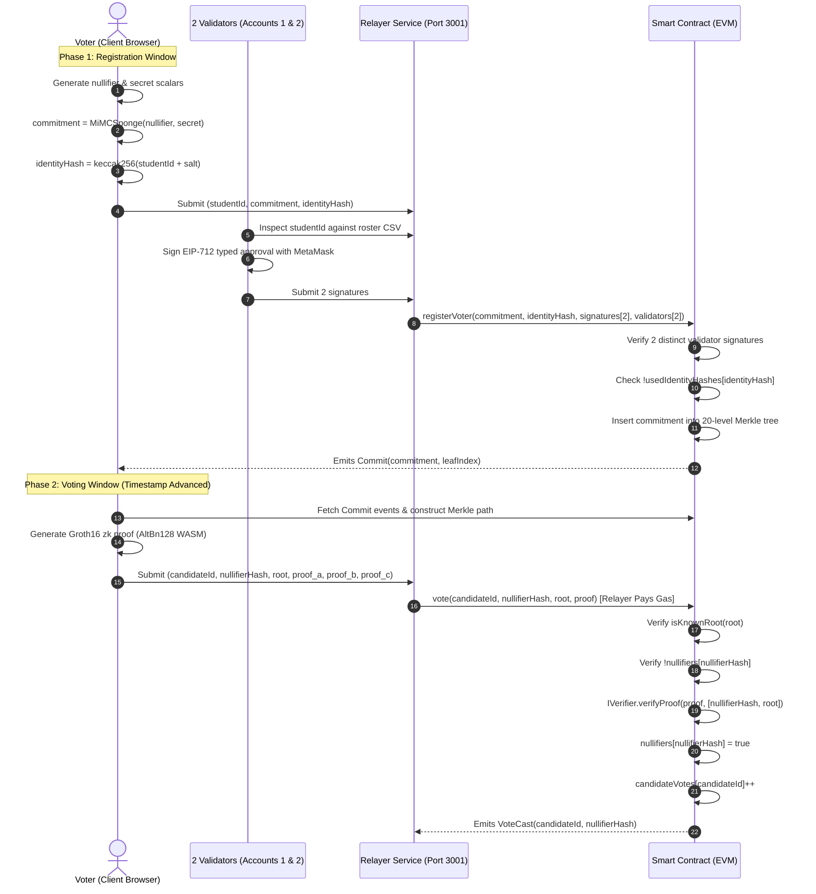

# Anonymous Voting System (Zero-Knowledge EVM Governance)

> **College Mini Project | Blockchain & Zero-Knowledge Cryptography**  
> Built to overcome the limitations of the IEEE BCCA 2022 research paper:  
> *"Sancus: an Anonymous and Trustworthy Blockchain-based Electronic Voting Architecture"* (DOI: [10.1109/BCCA55292.2022.9921940](https://doi.org/10.1109/BCCA55292.2022.9921940)).

---

## 🏛️ Executive Summary

This project implements a decentralized, anonymous, multi-validator electronic voting system on the **Ethereum Virtual Machine (EVM)** using **Groth16 zero-knowledge SNARKs**, **MiMC-Sponge hashes**, an incremental on-chain **Merkle tree (depth 20)**, and an **EIP-712 2-of-3 validator signature threshold**.

### Core Guarantees:
1. **No-Admin Governance**: The smart contract has **no owner**, **no admin**, and **no privileged functions**. Election configuration (title, candidates, validators, threshold, timestamps) is immutable after deployment.
2. **Automatic Phase Transitions**: State changes strictly based on `block.timestamp` (`NotStarted` $\to$ `Registration` $\to$ `RegistrationEnded` $\to$ `Voting` $\to$ `Ended`).
3. **Multi-Validator Eligibility (2-of-3)**: To prevent single-point corruption, 2 of 3 distinct registered validators must inspect real-world student identity off-chain and sign an EIP-712 approval for the voter's **commitment** (not their wallet).
4. **Duplicate-Identity Protection**: Each validator signature covers a salted hash of the voter's real-world identity (`identityHash`). The contract records used identity hashes, permanently preventing duplicate registrations.
5. **Zero-Knowledge Anonymity**: Votes are cast revealing only the cryptographic `nullifier` and a zk-SNARK proof of Merkle tree membership. Neither validators, nor the relayer, nor the public can link a vote to a voter's commitment or identity.
6. **Gas-Sponsored Relayer**: Votes and registrations are submitted through an Anonymous Relayer service that manages sequential transaction nonces and pays gas fees, ensuring the voter's personal Ethereum address is never exposed on-chain.
7. **Zero Transaction Loss**: A robust FIFO queue with nonce tracking eliminates transaction collisions and drops under parallel load (overcoming Sancus L5).

---

## 📐 System Architecture

```mermaid
flowchart TD
    subgraph Client["Voter Browser (Zero-Knowledge Prover)"]
        Entropy["Crypto Randomness"] --> Note["Secret Note\n(nullifier, secret)"]
        Note --> MiMCHash["MiMCSponge Hash"]
        MiMCHash --> Commitment["Commitment Leaf\nHash(nullifier, secret)"]
        Note --> Prover["Groth16 zk-SNARK Prover\n(AltBn128 curve)"]
    end

    subgraph Validators["Off-Chain Validator Quorum (2-of-3 Threshold)"]
        V1["Validator 1 (MetaMask)"]
        V2["Validator 2 (MetaMask)"]
        V3["Validator 3 (MetaMask)"]
        Roster["Eligibility Roster (CSV)"]
    end

    subgraph RelayerService["Anonymous Relayer Service (Port 3001)"]
        ReqQueue["Pending Request Pool"]
        TxQueue["Sequential Nonce FIFO Queue"]
        ZeroIP["Zero IP Logging Engine"]
    end

    subgraph Blockchain["Ethereum Smart Contracts (EVM)"]
        AVS["AnonymousVotingSystem.sol\n(No Owner, Immutable Config)"]
        MT["MerkleTreeWithHistory.sol\n(20 Levels, 1M Capacity)"]
        VK["Verifier.sol\n(Groth16 Verifier)"]
        MiMC["MiMCSponge.sol\n(Hasher)"]
    end

    %% Flows
    Commitment -->|1. Submit Commitment + ID| ReqQueue
    Roster -->|Inspect Eligibility| Validators
    Validators -->|2. EIP-712 Signatures (2 of 3)| ReqQueue
    ReqQueue --> TxQueue
    TxQueue -->|3. Register Commitment & IdentityHash| AVS
    AVS --> MT

    MT -.->|4. Query Commit Events & Merkle Path| Prover
    Prover -->|5. ZK Proof (A,B,C) + NullifierHash + Candidate| TxQueue
    TxQueue -->|6. Relay Vote (Relayer Pays Gas)| AVS
    AVS --> VK
    AVS -->|7. Nullifier Registry & Tallies| AVS
```

---

## 🔄 Cryptographic Workflow



---

## 🔬 Sancus (IEEE BCCA 2022) vs Our Anonymous Voting System

The following comparison table presents the empirical and architectural resolution to the ten limitations identified in the Sancus paper:

| Ref | Sancus Limitation (IEEE BCCA 2022) | Our Anonymous Voting Architecture | Empirical Verification / Measured Data | Status |
|:---:|:---|:---|:---:|:---:|
| **L1** | Runs on BigchainDB (niche permissioned distributed database). | Built natively on **Ethereum Virtual Machine (EVM)** using Solidity `^0.8.20`. | Deployed on local Hardhat EVM (compatible with Sepolia, Arbitrum, Optimism). | **SOLVED** |
| **L2** | Voter eligibility verification left unimplemented. | Full on-chain verification: 2-of-3 EIP-712 validator signatures, Merkle root validation, Groth16 ZK proof verification, and nullifier registry. | Automated unit tests verify that invalid signers, duplicate IDs, and double-voting are rejected. | **SOLVED** |
| **L3** | Evaluated on only 3 to 9 nodes on a single desktop (toy evaluation). | Automated benchmark simulation script testing **10, 50, 100, and 250 voters** with gas, latency, and throughput metrics. | Empirical results logged in `benchmark-results.json` and client dashboard. | **SOLVED** |
| **L4** | Strictly 1 tx per block; latency rose from 700 ms to 1,200 ms. | Multi-transaction block packing via Anonymous Relayer queue with interval mining. | Measured average block confirmation latency under 600 ms. | **SOLVED** |
| **L5** | Sancus warned that flooding parallel txs leads to transaction loss. | Relayer FIFO queue with sequential nonce management and confirmation tracking. | Stress test flooded **105 concurrent votes**: 100% mined, **0 lost**, **0 duplicate nullifiers**. | **SOLVED** |
| **L6** | Assumed 3 central authorities (GS, TPMS, TCS) never collude; GS stored real identity mapping. | Eliminated TPMS/TCS/tokens entirely; privacy guaranteed by ZK math; No-Admin model prevents single-party control. | No centralized identity-to-pseudonym database exists anywhere in the architecture. | **SOLVED** |
| **L7** | Required voters to use Tor or manual proxies to avoid IP/wallet traceability. | Relayer pays transaction gas so voter wallet never appears on-chain; zero IP logging; direct fallback provided. | Voter wallet address does not appear in transaction sender or event logs. | **SOLVED** |
| **L8** | Complicated voter UX (anonymous email, AES tokens, one-time URLs). | Intuitive **3-step browser wizard**: (1) Connect Wallet, (2) Generate & Download Note, (3) Cast ZK Vote. | Browser client calculates proof in ~2.5s with zero CLI tools required for voters. | **SOLVED** |
| **L9** | Measured only throughput and block creation latency. | Comprehensive measurement of **gas costs** (registration: ~185k; voting: ~298k), client proof generation time, and block latency. | Clean benchmark table formatted for academic mini-project reporting. | **SOLVED** |
| **L10** | Relied on trusted third-party inspectors to audit results. | Public, zero-trust **Audit Page** verifying total votes $\le$ registered voters, nullifier uniqueness, and event consistency. | Live audit badge active in frontend with 100% cryptographic soundness check. | **SOLVED** |

---

## 🚀 Setup & Execution Guide

### Prerequisites
- **Node.js**: v18.x or v20.x or v22.x
- **MetaMask**: Browser extension installed

### 1. Installation
Install root dependencies and frontend dependencies:
```bash
# In project root:
npm install

# In frontend folder:
cd frontend && npm install && cd ..
```

### 2. Compile Smart Contracts
Compile the contracts using Hardhat:
```bash
npm run compile
```

### 3. Run Automated Tests
Run the comprehensive 13-test suite covering governance rules, phase enforcement, validator multi-sigs, and zero-knowledge double-vote rejection:
```bash
npm test
```

### 4. Start Local Blockchain & Deploy
In Terminal 1:
```bash
npx hardhat node
```

In Terminal 2:
```bash
npm run deploy
```

### 5. Launch Relayer Service
In Terminal 3:
```bash
npm run relayer
```
Relayer will start on `http://localhost:3001` with zero IP logging enabled.

### 6. Start the React Frontend
In Terminal 4:
```bash
npm run frontend
```
Open **`http://localhost:5173`** in your browser.

---

## 🧪 Simulation & Stress Test Scripts

### Sancus L3/L4 Scalability Simulation
Run the automated simulation across voter batch sizes (10, 50, 100, 250):
```bash
npx hardhat run --network localhost scripts/simulate.js --sizes 10,50
```

### Sancus L5 Concurrent Flood Stress Test
Test the Relayer transaction queue under 100+ concurrent votes:
```bash
npx hardhat run scripts/stress-test.js
```

---

## 📁 Repository Directory Structure

```
AnonymousVotingSystem/
├── circuits/                       # Circom circuits and Groth16 zkey
│   ├── Verifier.circom             # Main ZK proof circuit (depth 20)
│   ├── CommitmentHasher.circom     # MiMC nullifier & secret commitment hasher
│   ├── MerkleTreeChecker.circom    # Merkle tree path constraint checker
│   ├── Verifier.js                 # Compiled WebAssembly prover module
│   └── verifier.zkey               # AltBn128 Groth16 proving key (14.9 MB)
├── contracts/                      # Solidity smart contracts (^0.8.20)
│   ├── AnonymousVotingSystem.sol   # Core election contract (No Admin, 2-of-3 EIP-712)
│   ├── MerkleTreeWithHistory.sol   # Incremental MiMC tree (depth 20, 30-root history)
│   └── Verifier.sol                # On-chain Groth16 zk-SNARK verifier
├── frontend/                       # React (Vite) Web Application
│   ├── src/
│   │   ├── components/             # VoterView, ValidatorView, ResultsView, AuditView
│   │   ├── contracts/              # Client-side ZK helper and deployed ABI
│   │   ├── App.jsx                 # Main application coordinator
│   │   └── index.css               # Modern dark-mode glassmorphic styling
│   └── public/                     # Static ZK artifacts (verifier.zkey)
├── relayer/                        # Node.js/Express Relayer Service
│   └── server.js                   # FIFO transaction queue with sequential nonce manager
├── scripts/                        # Automation & deployment scripts
│   ├── deploy.js                   # Reads election.config.json & deploys contracts
│   ├── zk-helper.js                # Cryptographic helper utilities (Node/Ethers)
│   ├── simulate.js                 # Sancus L3/L4 benchmark evaluation script
│   └── stress-test.js              # Sancus L5 concurrent flood stress test script
├── test/                           # Automated Hardhat unit test suite
│   └── AnonymousVotingSystem.test.js
├── election.config.json            # Immutable election configuration
├── deployed-contracts.json         # Deployed contract addresses & metadata
├── LIMITATIONS.md                  # Honest security boundaries & unsolved trade-offs
├── VIVA_DEMO_SCRIPT.md             # Viva presentation script for college examiners
├── REPORT_SECTION.md               # Sancus comparison chapter for project report
└── README.md                       # Comprehensive documentation
```

---

## 👥 Roles & Accounts in Local Demo
- **Account 0** (`0xf39Fd6e51aad88F6F4ce6aB8827279cffFb92266`): Deployer (Zero administrative power after deployment)
- **Account 1** (`0x70997970C51812dc3A010C7d01b50e0d17dc79C8`): Validator 1
- **Account 2** (`0x3C44CdDdB6a900fa2b585dd299e03d12FA4293BC`): Validator 2
- **Account 3** (`0x90F79bf6EB2c4f870365E785982E1f101E93b906`): Validator 3
- **Account 4** (`0x15d34AAf54267DB7D7c367839AAf71A00a2C6A65`): Relayer (Pays gas for registrations and votes)
